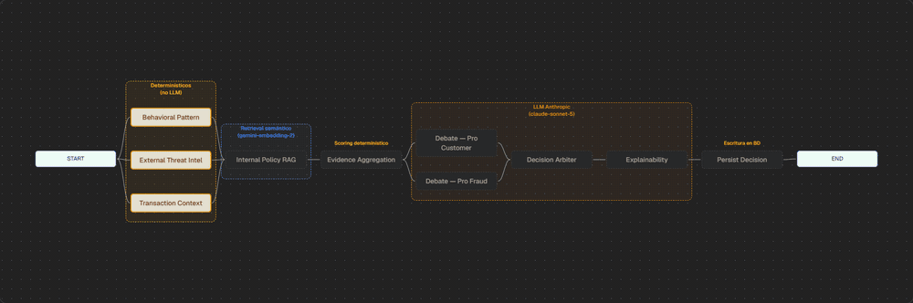

# Sistema Multi-Agente de Detección de Fraude

Un equipo de agentes analiza una transacción financiera con señales ambiguas
—un monto inusual, un horario atípico, un dispositivo desconocido— y decide
`APPROVE`, `CHALLENGE`, `BLOCK` o `ESCALATE_TO_HUMAN`. Cada decisión queda
**trazable**: qué evidencia la sostuvo, qué política interna la autoriza, qué
argumentaron los agentes y con qué versión de cada modelo y prompt se produjo.
Lo que no alcanza confianza suficiente pasa a una cola de revisión humana.



*Una transacción real recorriendo el grafo en el dashboard. Los primeros pasos van
en cámara lenta: en tiempo real duran milisegundos.*

## Demo en vivo

El mismo sistema, desplegado en dos nubes desde la rama `main`:

- **Azure Container Apps:** https://ca-fraud-detection-api.graywave-cc1ab2d2.eastus2.azurecontainerapps.io
- **GCP Cloud Run:** https://fraud-detection-api-im2rcartea-uc.a.run.app (escala a cero:
  la primera carga puede tardar unos segundos)

En **Transactions** puedes ejecutar un caso y verlo recorrer el grafo en vivo. Si
termina en *Derivado al analista*, puedes resolverlo tú en la pestaña **Human-in-the-loop (HITL)**.

> Proyecto final del programa de especialización en IA Generativa.

---

## Recorrido de una transacción

1. Llega la transacción: la API responde 202 y el análisis corre en segundo plano.
2. Tres sensores en paralelo, con reglas: contexto, comportamiento e inteligencia externa.
3. RAG de políticas: cita las que dispararon y busca otras relacionadas.
4. Agregación: puntaje de riesgo y confianza, sin LLM.
5. Debate: dos agentes LLM argumentan a favor y en contra, en paralelo.
6. Árbitro: el LLM decide sin bajar el piso de las reglas.
7. Explicación: el LLM redacta una explicación adecuada para el usuario y la decisión se persiste en BD.
8. Si el veredicto necesita revisión de un humano, el caso entra a la cola Human-in-the-loop (HITL).

Tres decisiones de diseño sostienen ese recorrido:

- **Las reglas fijan un piso y el LLM sólo puede subirlo.** Si el árbitro intenta
  aprobar algo que las reglas bloquearon, el caso falla en vez de guardarse
  ([ADR-0016](docs/adr/0016-el-arbitro-con-llm-escala-pero-no-cruza-el-piso-determinista.md)).
- **La cita que autoriza el veredicto no sale de la búsqueda vectorial.** Se
  resuelve por identidad, desde la política que disparó; la similitud sólo agrega
  contexto. Así el sistema no puede justificar una decisión con una norma que no
  evaluó ([ADR-0011](docs/adr/0011-citacion-por-identidad-descubrimiento-por-similitud.md)).
- **Un agente caído no tumba el análisis.** Cada agente de evidencia degrada solo;
  si falla el árbitro, el caso se escala a un humano en vez de inventar.

El detalle (topología, modelo de datos, sellos de auditoría) está en
[docs/arquitectura.md](docs/arquitectura.md).

---

## Cómo se evalúa

| Qué se mide | Método | Resultado |
|---|---|---|
| Motor de reglas | Match exacto contra el ground truth, como gate de CI | **7000/7000** |
| Recuperación semántica | recall@1 y MRR sobre las 653 transacciones con política esperada | **0.79 / 0.88** |
| Razonamiento de los agentes | LLM-as-judge (DeepEval) sobre un golden set curado | Se vigila por tendencia; nunca bloquea el CI |

**Donde hay respuesta correcta, se compara; donde no la hay, se juzga, y el juicio
se declara como tal**
([ADR-0013](docs/adr/0013-que-se-mide-con-metricas-duras-y-que-con-llm-as-judge.md)).

- **Por qué no F1 ni precisión.** El motor de reglas no es un clasificador que
  pueda equivocarse en cualquier dirección: ejecuta once políticas. Se valida
  contra una segunda implementación independiente, escrita a mano. Si difieren en
  una sola fila no es "99,99 % de acierto": es un bug en alguno de los dos lados.
- **Por qué recall sin precisión.** El ground truth dice qué citas son
  obligatorias, no cuáles están prohibidas. Una política relacionada que no
  disparó es descubrimiento, no un falso positivo.
- **Por qué k=1.** Con once documentos, recall@10 mide el tamaño del corpus. A
  k=1 el recuperador tiene que acertar la política exacta: 0.79 contra un piso de
  azar de 0.09.
- **Lo que infla el número, dicho primero.** La consulta se arma con casi el mismo
  texto que el documento indexado, así que el recall es alto en parte por
  construcción. Además, es una ablación: en producción la cita obligatoria se
  resuelve por identidad, no por similitud.
- **Por qué el LLM-as-judge no es un gate.** Su puntaje oscila entre corridas
  (DeepEval lo marca `flaky`). Un gate que falla por ruido enseña a reintentar
  hasta que pase. Corre sobre 7 casos curados, uno por veredicto más los casos
  límite, y se reporta.

Además, cada modelo candidato se evalúa en sombra antes de adoptarlo, con datos de
producción: [Jev como árbitro](docs/evaluaciones/jev-como-arbitro.md) (descartado:
no escaló ninguno de los casos que debían escalar),
[Sonnet 5.5](docs/evaluaciones/sonnet-5-5.md) (decide igual que Sonnet 5, pero
no resultó más rápido ni más barato) y la
[consistencia del árbitro](docs/evaluaciones/consistencia-del-arbitro.md) entre
corridas repetidas.

---

## Costo y latencia por nodo

Promedio de las últimas 64 ejecuciones (30/09 a 13/10/2026), medidas con
LangSmith. El dato en vivo está en la pestaña **Observability** de la demo.

| Nodo | Latencia prom. | Tokens prom. | Costo prom. |
|---|---|---|---|
| Transaction Context | 0,11 s | — | — |
| Behavioral Pattern | 0,16 s | — | — |
| External Threat Intel | 0,12 s | — | — |
| Internal Policy RAG | 2,23 s | — | — |
| Evidence Aggregation | < 0,01 s | — | — |
| Debate · Pro Fraud | 5,53 s | 811 | USD 0,0036 |
| Debate · Pro Customer | 6,09 s | 860 | USD 0,0038 |
| Decision Arbiter | 3,97 s | 2 020 | USD 0,0060 |
| Explainability | 2,31 s | 663 | USD 0,0024 |
| Persist Decision | 0,17 s | — | — |
| **Por decisión** | **~15 s** (camino crítico) | **~4 350** | **~USD 0,016** |

Los cinco primeros nodos no generan texto con un LLM (el RAG sólo calcula
embeddings): la aritmética y las reglas las resuelve código determinístico, y el
modelo entra sólo donde hay juicio
([ADR-0006](docs/adr/0006-reparto-deterministico-y-llm.md)). Los sensores y el
debate corren en paralelo, por eso la latencia total es menor que la suma.

---

## Stack

| | |
|---|---|
| Agentes | LangGraph · Claude Sonnet 5 (debate, árbitro, explicación) · Claude Haiku + búsqueda web (inteligencia externa) |
| RAG | Gemini Embedding 2 · PostgreSQL + pgvector (una sola base para datos, vectores y auditoría) |
| Backend | Python 3.12 · FastAPI · SQLAlchemy 2 async · Alembic · Pydantic v2 |
| Frontend | React · TypeScript · React Flow |
| Evaluación y observabilidad | DeepEval · LangSmith · OpenTelemetry + Grafana |
| Infra | Docker · GitHub Actions · Terraform · Azure Container Apps · GCP Cloud Run · Neon |

---

## Estructura

```
├── src/multiagent_fraud_detection/
│   ├── graph/          # estado, nodos y topología del grafo (LangGraph)
│   ├── domain/         # motor de reglas: predicados y catálogo de políticas
│   ├── retrieval/      # RAG: chunking, embeddings, índice y citas
│   ├── intel/          # inteligencia externa: búsqueda web gobernada
│   ├── debate/         # las dos posturas del debate, con LLM
│   ├── arbiter/        # veredicto final: LLM sobre el piso de las reglas
│   ├── explain/        # explicación de auditoría y al cliente
│   ├── api/            # FastAPI, progreso en vivo por SSE y cola HITL
│   ├── schemas/        # contratos de la frontera (Pydantic)
│   ├── db/             # modelos, repositorios y sesión async
│   └── config/         # settings y observabilidad
├── dashboard/          # frontend del analista (React + Vite), servido por la API
├── data/               # dataset sintético, ground truth, políticas y golden set
├── tests/              # pytest: sin red ni base
├── scripts/            # seed, gates, smoke tests y generadores
├── migrations/         # migraciones de Alembic
├── infra/              # Terraform de Azure y GCP
├── observability/      # stack local: Alloy, Loki, Tempo, Prometheus, Grafana
├── .github/workflows/  # CI y deploy a cada nube
└── docs/
    ├── arquitectura.md       # topología, modelo de datos, citas y sellos
    ├── desarrollo.md         # puesta en marcha, gates y scripts
    ├── contrato_de_interfaz.md
    ├── adr/                  # 34 decisiones de diseño, con sus alternativas
    ├── evaluaciones/         # modelos candidatos y consistencia del árbitro
    ├── incidentes/           # 13 incidentes de producción, con causa y arreglo
    ├── reviews/              # cierre de cada etapa
    └── diagrams/
```

---

## Correr en local

Requisitos: Python 3.12, [uv](https://docs.astral.sh/uv/getting-started/installation/),
Node 22 y Docker.

**Backend** (API en http://localhost:8000):

```bash
uv sync
cp .env.example .env          # completar ANTHROPIC_API_KEY y GEMINI_API_KEY
docker compose up -d          # Postgres 18 + pgvector
uv run alembic upgrade head
uv run python scripts/seed.py # dataset, catálogo de políticas e índice vectorial
uv run uvicorn multiagent_fraud_detection.api.app:app --reload
```

**Dashboard** (en otra terminal, http://localhost:5173; las llamadas a `/api`
van por proxy al backend):

```bash
cd dashboard
npm ci
npm run dev
```

**Las claves.** `ANTHROPIC_API_KEY` es la que hace funcionar el debate, el árbitro y
la explicación al cliente. Sin ella el grafo corre igual, pero el árbitro no puede
juzgar y **todo caso termina escalado a un humano**. `GEMINI_API_KEY` alimenta el
índice vectorial: sin ella las citas obligatorias se resuelven igual, pero no hay
descubrimiento de políticas relacionadas. `LANGSMITH_API_KEY` es opcional: sin
ella la vista *Observability* muestra "sin datos". Cada análisis cuesta
~USD 0,016 en Anthropic.

**La base arranca sin casos.** La pestaña *Transactions* trae escenarios listos
para ejecutar. La vitrina de casos destacados se llena con
`uv run python scripts/seed_showcase.py`, que corre 5 casos con LLM real.

**Pruebas:** `uv run pytest` corre sin red ni base. Los gates, smoke tests y
generadores están en [docs/desarrollo.md](docs/desarrollo.md).

---

## Documentación

- [Arquitectura](docs/arquitectura.md): topología del grafo, modelo de datos, cómo se arma una cita y los sellos de auditoría.
- [Desarrollo](docs/desarrollo.md): puesta en marcha, verificación, datos de demo y diagramas.
- [Contrato de interfaz](docs/contrato_de_interfaz.md): endpoints, schemas y persistencia.
- [Decisiones de diseño (ADR)](docs/adr/), [evaluaciones](docs/evaluaciones/) e [incidentes](docs/incidentes/).
- [Dataset sintético](data/README.md) y [catálogo de políticas](docs/catalogo_de_politicas.md).

## Licencia

[MIT](LICENSE).
