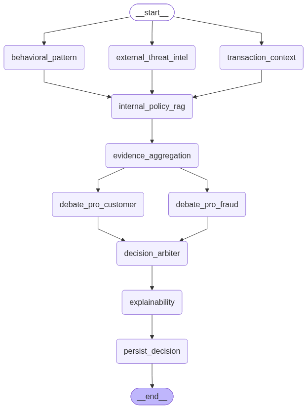
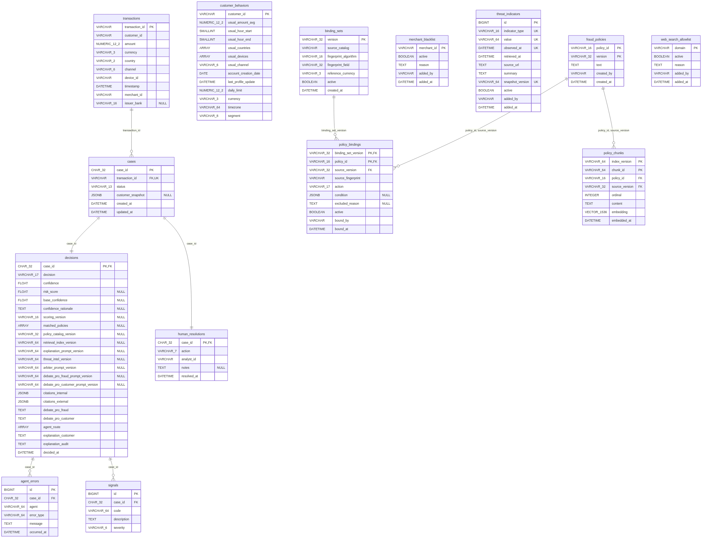

# Arquitectura

Cómo funciona el sistema por dentro: la topología del grafo, el modelo de datos,
cómo se arma una cita interna y qué sella cada decisión. La vista general está en
el [README](../README.md); las decisiones, con sus alternativas, en [adr/](adr/).

---

## Topología del grafo



La topología no se diseñó dibujando cajas: se derivó de las dependencias de
datos, con una sola regla —**dos nodos corren en paralelo si y solo si ninguno
lee lo que el otro escribe**—. De ahí salen siete *supersteps*:

| # | Nodos | Qué hace |
|---|---|---|
| 0 | `transaction_context` ∥ `behavioral_pattern` ∥ `external_threat_intel` | Recolección de evidencia |
| 1 | `internal_policy_rag` | Cita por identidad y descubre por similitud |
| 2 | `evidence_aggregation` | Deduplica, ordena y calcula la confianza determinística |
| 3 | `debate_pro_fraud` ∥ `debate_pro_customer` | Deliberación |
| 4–5 | `decision_arbiter` → `explainability` | Veredicto y explicación |
| 6 | `persist_decision` | Cierre |

El grafo no tiene aristas condicionales: `DECIDED` y `PENDING_HUMAN` son valores
de `status` que escribe el mismo nodo, no una bifurcación.

El diagrama se genera desde el grafo compilado
(`scripts/export_graph_diagram.py`), no se dibuja a mano.

> `decision_arbiter` es el Arbiter con LLM: decide el veredicto final sobre un
> **piso** determinístico —lo que el catálogo prescribe por precedencia
> (`prescribed_action`, el mismo cálculo que sigue siendo el brazo de control
> del entregable 7), que nunca es APPROVE si cayó un agente que produce señales
> ([ADR-0032](adr/0032-con-evidencia-incompleta-el-piso-no-es-approve.md))—. Puede escalar ese piso con justificación auditable en
> `confidence_rationale`; no puede bajarlo — lo hace cumplir una cuarta guarda
> estructural en `persist_decision`
> ([ADR-0006](adr/0006-reparto-deterministico-y-llm.md),
> [ADR-0016](adr/0016-el-arbitro-con-llm-escala-pero-no-cruza-el-piso-determinista.md)).

---

## Cómo se arma una cita interna

La decisión de fondo del sistema, y la que más se aparta de un RAG convencional:
**`citations_internal` no sale de la búsqueda vectorial**.

Si saliera, el motor podría disparar FP-03, el índice devolver FP-05 y FP-02, y
el caso decidirse `BLOCK` —correctamente— **citando normas que no aplicó**. No
hay excepción, la lista no está vacía, y el auditor recibe una explicación
coherente y falsa.

Por eso se resuelve por dos caminos, y lo que se persiste es su unión
([ADR-0011](adr/0011-citacion-por-identidad-descubrimiento-por-similitud.md)):

| Camino | Cómo | Aporta | Garantía |
|---|---|---|---|
| **Autorización** | lookup por `policy_id` contra el catálogo | toda política que disparó | **total** |
| **Descubrimiento** | búsqueda vectorial desde los códigos de señal | políticas relacionadas que **no** dispararon | ninguna |

La autorización **no consulta el índice ni la red**: por eso sobrevive a un
documento publicado y sin indexar, y a que el proveedor de embeddings no
responda. Verificado: con el proveedor caído, el mismo caso sigue en `BLOCK`
citando FP-03, con la confianza degradada de 0.4 a 0.25.

---

## Modelo de datos



Catorce tablas. También se **genera** desde `Base.metadata`
(`scripts/export_data_model_diagram.py`), por el mismo motivo por el que se
genera la topología: el diagrama dibujado a mano se había atrasado dos etapas sin
que nadie lo notara.

```bash
uv run python scripts/export_data_model_diagram.py --check   # gate, sin red
```

Retorna distinto de cero si el modelo cambió y el diagrama no. Junto a
`alembic check` cubre los dos desfases posibles: modelo sin migración y modelo
sin diagrama.

---

## Auditoría en cinco ejes

Cada decisión sella con qué se produjo. Ninguno de los cinco se puede derivar de
los otros, porque los cinco artefactos cambian por separado:

| Eje | Sello | `null` significa |
|---|---|---|
| Qué texto se citó | `InternalCitation.version` | — |
| Qué traducción se evaluó | `policy_catalog_version` | — |
| Con qué índice se recuperó | `retrieval_index_version` | no hubo recuperación |
| Con qué prompt se redactó | `explanation_prompt_version` | ningún modelo participó |
| Con qué snapshot se consultó | `threat_intel_version` | no se consultó inteligencia externa |

Además, cada salida de un LLM que queda en la decisión sella el modelo y el prompt
que la produjo ([ADR-0033](adr/0033-cada-texto-o-juicio-de-un-llm-que-se-guarda-lleva-su-version.md)):
`arbiter_prompt_version` (el veredicto), `debate_pro_fraud_prompt_version` y
`debate_pro_customer_prompt_version` (los argumentos del debate). `null` significa
que ningún modelo la produjo: el árbitro degradó o el argumento salió del respaldo.

Las cadenas son descriptivas y no identificadores opacos
(`gemini-embedding-2:1536:doc:1`): el motivo de sellarlas es que alguien las lea.
Por lo mismo, **el modelo no es variable de entorno** — uno configurable por
`env` podría cambiarse sin que suba la versión sellada, y los cinco sellos
mentirían a la vez ([ADR-0012](adr/0012-el-indice-vectorial-es-dato-derivado-y-versionado.md),
[ADR-0014](adr/0014-la-inteligencia-externa-se-recoge-en-build-y-se-consulta-congelada.md)).

---

## Stack

| Herramienta | Rol |
|---|---|
| Python 3.12 · [uv](https://docs.astral.sh/uv/) | Runtime y gestor de proyecto (build reproducible con `uv.lock`) |
| PostgreSQL 18 + pgvector | Base relacional **y** vectorial ([ADR-0001](adr/0001-postgres-con-pgvector-como-unica-base.md)) |
| SQLAlchemy 2.0 (async) + psycopg3 | ORM y driver |
| Alembic | Migraciones versionadas (motor síncrono) |
| Pydantic v2 | Validación en la frontera |
| LangGraph | Orquestación del grafo de agentes |
| Gemini (`gemini-embedding-2`) | Embeddings: recuperación |
| Anthropic (`claude-sonnet-5`) | Generación: debate, árbitro con salida estructurada y explicación al cliente |
| Anthropic (`claude-haiku-4-5`) | Inteligencia externa: búsqueda web gobernada, a demanda y fuera del análisis ([ADR-0014](adr/0014-la-inteligencia-externa-se-recoge-en-build-y-se-consulta-congelada.md), [ADR-0026](adr/0026-cada-llamada-a-un-llm-usa-el-modelo-mas-chico-que-alcanza.md), [ADR-0029](adr/0029-fetch-intel-a-demanda.md)) |

Dos proveedores, tres roles y tres sellos. Los tres entran **por un puerto**:
cambiar de proveedor es un adaptador y una versión nueva, no una reescritura.

El sistema corre en dos nubes desde la misma imagen: Azure Container Apps como
orquestador oficial
([ADR-0021](adr/0021-el-orquestador-es-azure-container-apps-gestionado-con-terraform.md)) y GCP Cloud Run
como segunda prueba de multi-nube, a modo de aprendizaje
([ADR-0022](adr/0022-gcp-cloud-run-como-segundo-target-de-aprendizaje.md)).
